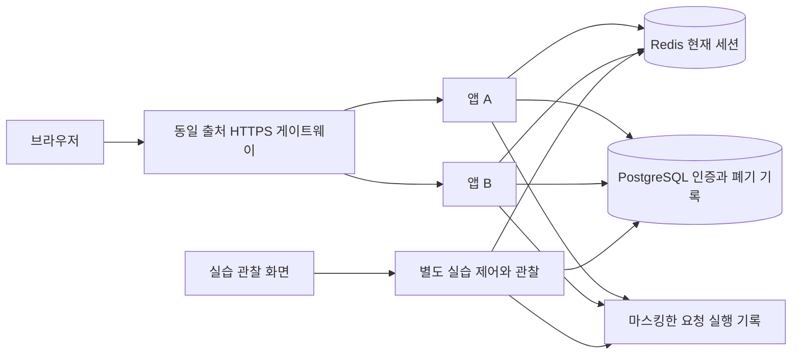
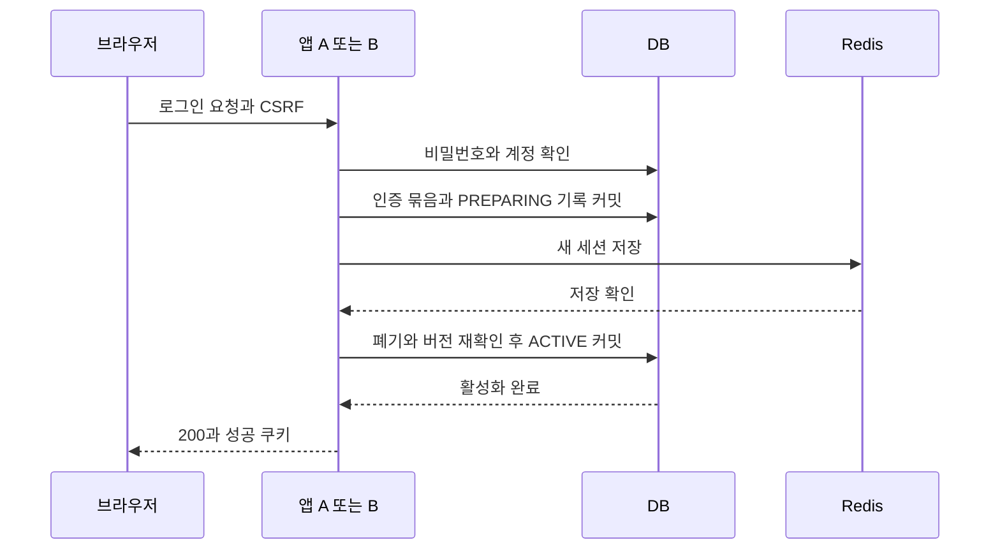
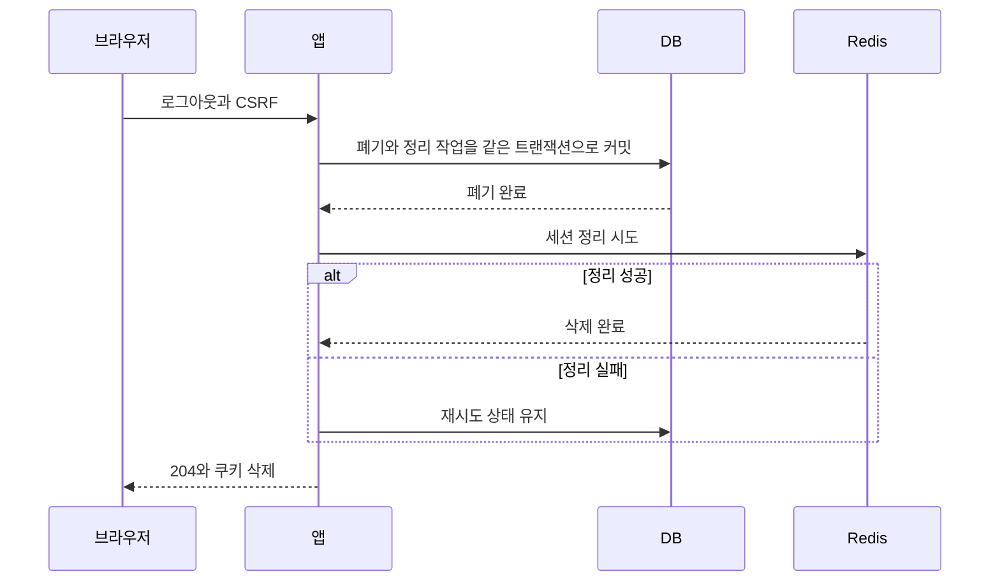

# 로그인과 로그인 유지 상세설계

기준일: 2026-10-18 KST. 상태: 구현 전 설계안.

이 프로젝트는 실제 로그인, 세션 만료, 로그인 유지에 의한 재인증, 기기별 로그아웃을 사용하면서 브라우저 요청과 서버·Redis·DB의 처리 결과를 함께 확인하는 독립 실습 서비스다. 설계 설명과 실제 실행 기록을 구분하고, 인증이 허용되거나 거부된 이유를 요청 단위로 확인한다.

사용자가 선택한 방향은 설계 시각화와 실제 백엔드 검증의 결합, 프로젝트 목적에 맞는 기술 선택이다. 아래 만료 시간과 세부 정책은 이 프로젝트의 제안값이다. 산출물은 설계 문서이며 애플리케이션 소스, 실행용 DDL, 설정, HTML 화면, 자동 테스트는 이번 단계에서 작성하지 않는다. 테스트표의 상태는 모두 실행 전이다.

## 1 목표와 범위

첫 버전에 포함할 기능은 다음과 같다.

- 준비된 계정의 아이디·비밀번호 로그인과 실패 처리.
- 일반 로그인과 로그인 유지 선택.
- Redis에 저장하는 서버 세션, 유휴 만료와 절대 만료.
- DB에 저장하는 로그인 유지 자격정보, 복원 시 토큰 교체와 폐기.
- 현재 브라우저 로그아웃, 다른 기기 인증 해제, 모든 기기 로그아웃.
- 민감한 기기 관리 전 비밀번호 재확인.
- 계정 비활성화와 인증 버전 변경 후 접근 차단.
- 두 애플리케이션 인스턴스 간 세션 공유.
- Redis·DB 장애, 응답 유실, 동시 복원, 로그아웃 경쟁 상황의 재현.
- 보호된 조회와 알림 설정 변경을 이용한 실제 접근 제어 검증.

회원가입, 비밀번호 재설정·변경 화면, 소셜 로그인, SSO, MFA, 운영 부하 수용량 인증은 후속 프로젝트에서 다룬다. 이 프로젝트에는 일반 계정과 기기 관리를 시험할 계정 등 독립 테스트 계정을 준비한다. 계정 비활성화와 인증 버전 변경은 격리된 실습 제어 기능으로 재현한다.

여기서 ‘기기’는 물리 장치를 식별한 결과가 아니라, 하나의 브라우저 프로필에서 발급받은 인증 묶음이다. 표시 이름과 User-Agent는 설명용이며 인증 근거로 사용하지 않는다. 일반 탭들은 쿠키를 공유하고, 서로 다른 사용자는 분리된 브라우저 프로필이나 컨텍스트로 검증한다.

## 2 반드시 유지할 규칙

| 규칙 | 설계상 보장 |
|---|---|
| 인증 성공 | Redis 세션과 DB 인증 기록이 모두 유효해야 보호 API에 접근한다. |
| 만료 | 서버가 판정한 유휴·절대 만료 시각 이후에는 해당 세션을 허용하지 않는다. |
| 로그인 유지 | 유효한 유지 자격정보로 새 세션을 발급하며, 만료된 세션을 되살리지 않는다. |
| 폐기 | DB에 폐기가 커밋된 후 새로 인증 검사를 시작하는 요청은 거부한다. |
| 복구 | 오래된 Redis 데이터가 돌아와도 DB에서 폐기된 인증은 허용하지 않는다. |
| 장애 | 저장소 접근 실패는 503으로 처리하고 인증 실패 401과 구분한다. |
| 동시성 | 같은 유지 토큰의 동시 복원에서 교체를 성공시키는 요청은 하나다. |
| 관찰 | 실습 화면의 자동 관찰은 사용자의 세션 수명을 연장하지 않는다. |
| 민감정보 | 비밀번호, 인증 쿠키, CSRF 토큰 원문을 흐름 화면이나 검증 보고서에 남기지 않는다. |

폐기 보장의 기준은 요청의 인증 검사 시점이다. 로그아웃 커밋 전에 인증 검사를 통과하여 이미 실행 중인 요청까지 소급 취소하지 않는다. 보호된 쓰기 작업은 해당 작업의 트랜잭션 안에서 인증 버전·폐기를 다시 확인한 뒤 변경을 확정한다.

## 3 기술과 실행 구성

| 영역 | 선택안과 이유 |
|---|---|
| 화면 | React·TypeScript. 서비스 화면과 흐름·검증 화면의 상태를 분리한다. |
| 인증 | Java 21·Spring Boot·Spring Security. 비밀번호 검증, 세션 고정 공격 방지, CSRF, 인증 수준 구분을 활용한다. |
| 현재 세션 | Spring Session Redis. 두 서버가 같은 세션 저장소를 이용한다. |
| 영속 기록 | PostgreSQL. 사용자, 기기 인증 묶음, 유지 자격정보, 세션 발급·폐기 기록을 보존한다. |
| 테스트 | Playwright, 실제 PostgreSQL·Redis를 사용하는 서버 통합 테스트. 장애 프록시와 서버 처리 지점의 시험용 차단 기능을 사용한다. |
| 로컬 실행 | HTTPS 게이트웨이, 앱 A·B, Redis, PostgreSQL, 실습 제어·관찰 프로세스. |

Spring Session은 Redis 세션 저장소를 제공한다. 기기 목록은 DB에서 조회하므로 기본 RedisSessionRepository를 사용하고, 만료 이벤트나 사용자별 Redis 인덱스에 폐기 보장을 의존하지 않는다. [Spring Session Redis 문서](https://docs.spring.io/spring-session/reference/configuration/redis.html)

로그인 유지의 해시 저장, 교체 경쟁 처리, 기기별 폐기 정책은 이 프로젝트의 확장 설계다. Spring Security의 RememberMeServices 등 확장 지점에 연결하며, 아래 동작을 프레임워크 기본 구현이 모두 제공한다고 가정하지 않는다. [Spring Security Remember-Me 문서](https://docs.spring.io/spring-security/reference/servlet/authentication/rememberme.html)

프레임워크와 DB·Redis의 세부 버전은 구현 착수 시 지원 범위와 호환성을 확인해 고정한다.

실제 앱은 하나의 출처에서 화면과 API를 제공한다. A·B는 게이트웨이 뒤의 서버 인스턴스이며 브라우저 호스트를 서버별로 나누지 않는다. 실습용 요청 분배와 응답의 서버 식별자로 A→B 전달을 확인한다.

포트폴리오는 프로젝트 진입과 설명을 제공하고 실제 실습은 별도 백엔드 실행 환경에 연결한다. GitHub Pages 같은 정적 호스팅만으로 실제 Redis·DB 인증을 실행한 것으로 표시하지 않는다.

### DB 확인을 매 요청 수행하는 이유

보호 요청마다 DB 주 저장소에서 세션 발급 기록, 기기 인증 묶음, 사용자 인증 버전을 함께 확인한다. Redis가 복구되거나 오래된 키가 재생성되어도 폐기를 유지하기 위한 선택이다. 읽기 복제본의 지연이나 폐기 상태의 로컬 캐시를 첫 버전에는 허용하지 않는다.

대신 요청마다 인덱스 기반 DB 조회 비용이 발생하고 DB 장애 시 기존 사용자도 보호 API를 이용할 수 없다. Redis의 역할은 세션 공유와 유휴 만료 관리이며, 이 구성만으로 DB 조회가 제거된다고 설명하지 않는다. 폐기 상태 캐시와 허용 가능한 반영 지연의 비교는 후속 실험이다.

## 4 화면 구성

데스크톱은 상단 시나리오·실행 상태, 왼쪽 실제 서비스, 가운데 처리 흐름, 오른쪽 데이터 관찰, 하단 실행 결과로 구성한다. 좁은 화면에서는 서비스·흐름·데이터·검증 탭으로 전환한다.

| 화면 | 구체적 구성과 동작 |
|---|---|
| 로그인 | 아이디, 비밀번호, 로그인 유지 체크박스, 기기 표시 이름, 로그인 버튼. 기본값은 로그인 유지 해제다. |
| 내 로그인 상태 | 사용자 표시명, PASSWORD 또는 REMEMBER 인증 방식, 유휴 만료·절대 만료·유지 만료 시각, 처리 서버, 보호 API 실행 버튼. |
| 보호된 설정 | 알림 설정 한 개를 조회·변경한다. 변경 전후 값과 서버 저장 결과를 확인한다. |
| 기기 관리 | 기기 이름, 발급 시각, 최근 인증 시각, 로그인 유지 여부, 현재 기기 표시, 유효·폐기·기간 종료 상태. 다른 기기 해제와 전체 로그아웃을 제공한다. |
| 비밀번호 재확인 | 다른 기기 해제·전체 로그아웃 전 최근 비밀번호 인증이 없으면 모달을 연다. 실패 시 원래 작업을 실행하지 않는다. |
| 만료 안내 | 일반 로그인은 재로그인 화면으로 이동한다. 유지 자격정보가 있으면 한 번 복원을 시도하고 성공 시 복원 사실을 알린다. |
| 장애 안내 | 서버 확인 불가 상태와 재시도 버튼을 표시한다. 저장소 장애를 비밀번호 오류나 로그아웃 완료로 표시하지 않는다. |
| 실습 제어 | 서버 A·B 경로 선택, 짧은 만료 정책, 장애 지점 선택, 동시 복원, 응답 유실, 데이터 초기화를 제공한다. |
| 실행 결과 | 요청 식별자, 서버, 단계별 결과와 시간, HTTP 상태, DB 변경, Redis 관찰, 검증 통과·실패·미판정을 보여준다. |

실습 제어 기능은 별도 실행 환경과 실행별 데이터에만 접근한다. 일반 사용자 API에는 Redis 중지·DB 조작·시간 변경 기능을 제공하지 않는다. 데이터 초기화도 해당 실행 범위로 제한한다.

두 기기 체험은 실제 분리된 브라우저 컨텍스트를 열어 수행한다. 같은 출처의 iframe 두 개만으로 서로 다른 사용자의 쿠키가 분리되었다고 판단하지 않는다.

### 흐름 화면에 표시할 단계

브라우저 요청 → CSRF·요청 검사 → Redis 세션 조회 → DB 유효성 확인 → 보호 동작 또는 인증 처리 → Redis 저장 → DB 확정 → 응답 순서를 해당 시나리오에 맞게 표시한다. 비밀번호 로그인에서는 비밀번호 검증 단계가 추가되고, 유지 복원에서는 토큰 검증·교체 단계가 추가된다.

요청별 실제 이벤트가 들어올 때만 실행 완료 표시를 한다. 설명용 미리보기에는 ‘설계 예시’, 기록 재생에는 ‘완료된 실행 재생’을 표시한다. API 성공, 데이터 확인 완료, 테스트 판정은 각각 별도 상태다.

관찰 데이터는 별도 제어·관찰 경로에서 조회한다. 이 경로는 사용자 인증 세션을 읽거나 저장하는 필터를 거치지 않는다. 내 상태 화면은 보호 API를 자동 폴링하지 않고 마지막 응답의 만료 시각으로 남은 시간을 표시한다. 실제 만료 여부는 다음 서버 요청에서 확정한다.

관찰 화면은 마지막 관찰 시각과 확인 가능 여부를 함께 표시한다. 저장소 조회 실패를 ‘세션 없음’이나 ‘삭제 완료’로 바꾸지 않는다. 서버가 수집한 이벤트가 없는 단계는 추정으로 성공 표시하지 않는다.

## 5 인증과 만료 정책

| 항목 | 기본 제안값 | 의미 |
|---|---:|---|
| 익명 CSRF 준비 세션 | 10분 | 로그인·복원 요청에 필요한 CSRF 준비에만 사용한다. 인증 권한은 없다. |
| 세션 유휴 시간 | 30분 | 마지막 정상 보호 요청 이후의 허용 시간이다. |
| 세션 절대 수명 | 8시간 | 세션 발급 이후의 최대 수명이며 활동으로 늘어나지 않는다. |
| 로그인 유지 수명 | 14일 | 최초 비밀번호 로그인 때 정하고 복원 시 연장하지 않는다. |
| 최근 비밀번호 확인 | 5분 | 다른 기기 해제와 전체 로그아웃에 필요하다. |
| 동시 복원 충돌 구분 | 5초 | 방금 사용한 이전 토큰을 정상 경쟁 요청으로 처리하는 시간이다. |
| 발급 준비 기록 수명 | 30초 | 활성화되지 않은 준비 기록을 정리하는 기준이다. |
| IP 단위 로그인 제한 | 1분에 20회 | 비밀번호 검증 자원 사용을 제한하는 시작값이다. |
| 계정 단위 실패 제한 | 5분에 5회 실패 | 다음 시도는 429와 Retry-After를 반환한다. |

위 수치는 서비스 운영 결과에 따른 기준이 아니라 실습 정책 제안이다. 계정 제한은 존재하지 않는 아이디에도 같은 외부 응답을 사용한다. 차단 중 요청이 올 때마다 제한 종료 시각을 계속 미루지 않는다. 로그인 성공은 계정 실패 횟수만 초기화하고 IP 요청 제한을 초기화하지 않는다. 제한 카운터는 Redis에서 원자적으로 변경한다.

세션 유효 종료는 유휴 종료 시각과 절대 종료 시각 중 빠른 시각이다. 로그인 유지로 발급한 세션은 유지 자격정보의 만료 시각도 넘지 못한다. 예를 들어 유지 만료 10분 전에 복원하면 새 세션의 최대 유효 시간도 10분이다.

절대 만료는 별도 서버 검사로 집행하고, Redis TTL은 유휴 시간과 남은 절대 유효 시간 중 짧은 값으로 제한한다. Redis 키 삭제 알림은 정리에만 활용한다. 인증 판정은 저장된 논리 시각과 DB 상태를 검증한다.

로그인 유지 사용자는 유휴·절대 만료 후 새 세션으로 복원할 수 있다. 따라서 ‘8시간 절대 수명’은 한 세션의 제한이며, 모든 사용자에게 8시간마다 비밀번호 입력을 강제한다는 의미가 아니다. 유지 기간이 끝나거나 인증이 폐기되면 비밀번호가 필요하다.

### 쿠키 정책

| 쿠키 | 속성과 수명 |
|---|---|
| __Host-auth_session | Secure, HttpOnly, SameSite=Lax, Path=/, Domain 없음. 일반 세션 쿠키로 발급한다. |
| __Host-remember_me | 같은 보안 속성. 불투명한 선택자와 비밀값으로 구성하고 Max-Age·Expires는 최초 14일 종료 시각의 남은 기간만 설정한다. |
| CSRF 준비 정보 | 서버 검증에 사용하는 프레임워크 CSRF 기능으로 관리한다. 화면에 전달하는 CSRF 값은 메모리에만 두고 인증 쿠키와 구분한다. |

인증정보를 localStorage에 저장하지 않는다. 아이디 저장 기능은 이번 범위에서 제외한다. 쿠키 속성 검증은 로컬에서도 HTTPS를 사용한다.

브라우저의 세션 복원 기능은 세션 쿠키도 재실행 때 되살릴 수 있다. 따라서 일반 로그인에 대해 ‘브라우저를 닫으면 반드시 로그아웃’이라고 보장하지 않는다. 종료·재실행 시험과 서버 만료·폐기 시험을 분리한다. [MDN Set-Cookie 문서](https://developer.mozilla.org/en-US/docs/Web/HTTP/Reference/Headers/Set-Cookie)

유휴·절대 만료와 인증 변경 시 세션 식별자 교체를 분리해 관리하는 원칙은 세션 관리 지침을 따른다. 구체적인 시간은 이 설계의 정책값이다. [OWASP 세션 관리 지침](https://cheatsheetseries.owasp.org/cheatsheets/Session_Management_Cheat_Sheet.html)

## 6 저장 데이터와 책임

| 저장소와 논리 데이터 | 주요 항목 | 책임 |
|---|---|---|
| DB users | userId, 정규화한 loginId, passwordHash, status, authVersion | 계정 상태와 전체 인증 버전의 기준이다. |
| DB device_auth_grants | grantId, userId, mode, 표시 이름, 발급 시각, 만료 시각, 발급 당시 authVersion, revokedAt | 한 브라우저 인증 묶음의 유효·폐기를 관리한다. 일반 로그인 묶음은 최대 8시간, 유지 묶음은 최대 14일이다. |
| DB auth_sessions | sessionRecordId, 세션 식별자 해시, grantId, PREPARING·ACTIVE·REVOKED 상태, 발급·절대 종료 시각, 발급 당시 authVersion | 실제로 허용할 세션의 발급 완료 여부를 관리한다. 유휴 시각은 Redis가 관리한다. |
| DB remember_credentials | 공개 선택자, grantId, 현재 비밀값 해시, 직전 비밀값 해시, 교체 세대, 직전 사용 시각, 고정 만료 시각 | 로그인 유지 검증과 동시 교체를 제어한다. |
| DB auth_cleanup_tasks | 대상 세션 참조, 처리 사유, 재시도 상태, 다음 시도 시각 | DB 폐기 후 실패한 Redis 정리를 재시도한다. 폐기 트랜잭션에 함께 저장한다. |
| DB auth_audit_events | 요청·실행 식별자, 사용자·기기 참조, 이벤트 종류, 결과, 서버 시각 | 발급·복원·폐기 원인을 기록한다. |
| DB user_preferences | userId, 알림 설정 값, version, updatedAt | 인증된 쓰기 작업의 실제 저장 결과를 검증한다. |
| Redis 인증 세션 | 사용자·기기·세션 기록 참조, 인증 방식, 최근 비밀번호 확인 시각, 유휴 정보, 절대 종료 시각, authVersion | 두 서버가 공유하는 현재 인증 문맥이다. |
| Redis 정리용 보조 인덱스 | 세션 기록 참조와 실제 저장 키의 대응, 기기별 세션 참조 | 원문 쿠키를 DB에 저장하지 않고 세션 정리 대상을 찾는다. 인증 판정에는 사용하지 않는다. |
| Redis 익명 세션과 제한 카운터 | CSRF 상태, 제한 카운터와 종료 시각 | 로그인 준비와 요청 제한을 담당한다. |

비밀번호는 PasswordEncoder의 적응형 단방향 해시로 저장한다. 사용자 존재 여부에 따라 외부 로그인 오류를 나누지 않고, 없는 사용자도 검증 비용을 급격히 줄이지 않는 처리를 둔다. [PasswordEncoder 문서](https://docs.spring.io/spring-security/reference/servlet/authentication/passwords/password-encoder.html)

유지 비밀값은 충분한 엔트로피의 난수로 발급하고 DB에는 검증용 해시만 보관한다. 해시 방식은 비밀번호 해시와 목적이 다르며, 임의의 비밀번호를 빠른 해시로 저장하는 데 사용하지 않는다. 원문은 쿠키를 응답할 때만 일시적으로 취급한다.

외부에 노출하는 세션 참조는 원본 쿠키 값과 다른 식별자다. 기기별 여러 세션이 생겨도 같은 grantId의 폐기로 모두 거부한다. 세션 정리와 상태 표시의 지연은 인증 허용 여부를 바꾸지 않는다.

정리 작업은 보조 인덱스로 실제 Redis 키를 찾아 삭제한다. 인덱스가 유실되면 전체 키를 무작정 순회하지 않고 해당 기록을 ‘키 정리 미확인’으로 표시하며 TTL 정리를 기다린다. 인덱스의 내부 저장 키는 화면·보고서에 노출하지 않는다. 이 인덱스 역시 프로젝트 확장 기능이다.

### 상태 전이

- 세션: ANONYMOUS → PREPARING → ACTIVE → EXPIRED 또는 REVOKED. ANONYMOUS에는 인증된 DB 세션 기록이 없다.
- 로그인 유지: ACTIVE 세대 N → 복원 성공 준비 시 세대 N+1 → EXPIRED 또는 REVOKED.
- 기기 인증 묶음: ACTIVE → EXPIRED 또는 REVOKED.
- 로그아웃 처리: REQUESTED → DB_REVOKED → REDIS_CLEANED. DB_REVOKED 이후에는 인증 거부가 확정된다.

EXPIRED는 현재 시각과 정책으로 판정할 수 있다. 정리 작업이 DB 상태를 갱신하거나 Redis 키를 실제 삭제할 때까지 기다려서 만료를 인정하지 않는다.

## 7 API 계약과 화면 반응

모든 변경 요청은 CSRF 검증을 거친다. 응답에는 요청 식별자와 처리 서버 식별자를 붙이고 인증 관련 응답은 Cache-Control: no-store로 전달한다. 보호 API는 로그인 HTML이나 302 대신 JSON 오류와 상태 코드를 반환한다.

| API | 처리와 성공 응답 | 주요 실패 |
|---|---|---|
| GET /api/auth/csrf | 200. 초기 화면·인증 변경 후 CSRF 준비. 인증 복원을 실행하지 않는다. | 503 저장소 접근 실패 |
| POST /api/auth/login | 아이디·비밀번호·rememberMe·기기 이름. 200과 인증 상태, 성공 쿠키. | 401 AUTHENTICATION_FAILED, 403 CSRF_INVALID, 429, 503 |
| GET /api/auth/me | 200과 사용자, 인증 방식, 기기 참조, 만료 시각. 세션이 없으면 새 인증 세션을 만들지 않는다. | 401 SESSION_REQUIRED·SESSION_EXPIRED·AUTH_REVOKED, 503 |
| POST /api/auth/restore | 유지 쿠키로 세션 발급과 유지 토큰 교체. 200과 새 쿠키. | 401 REMEMBER_INVALID·REMEMBER_EXPIRED·REMEMBER_STALE, 409 RESTORE_ALREADY_PROCESSED, 503 |
| POST /api/auth/reauthenticate | 비밀번호 재확인. 204. 현재 세션의 인증 수준 갱신과 세션 식별자 교체. | 401 REAUTHENTICATION_FAILED, 세션 무효 401, 429, 503 |
| GET /api/auth/devices | 200. 자기 기기 인증 묶음 목록과 유효 상태. | 401, 503 |
| DELETE /api/auth/devices/{grantId} | 최근 비밀번호 확인 후 대상 기기 폐기. 204. 다른 사람의 참조는 404. | 403 REAUTH_REQUIRED, 404, 503 |
| POST /api/auth/logout | 현재 기기의 인증 묶음 폐기. 204와 쿠키 삭제. | CSRF 실패, 커밋 전 장애 503 |
| POST /api/auth/logout-all | 최근 비밀번호 확인 후 authVersion 증가와 전체 기기 폐기. 204와 쿠키 삭제. | 403 REAUTH_REQUIRED, 503 |
| GET /api/protected/report | 200. 인증된 실제 서버 조회 결과. | 401, 503 |
| PATCH /api/protected/preferences | 알림 설정 변경. 200과 저장 값·version. 인증 유효성을 트랜잭션에서 재확인한다. | 401, 403, 503 |

로그아웃 반복 요청의 의미는 추가 인증 효과 없이 이미 해제된 상태를 유지하는 것이다. 익명 상태에서는 유효한 CSRF 준비를 거쳐 204를 반환할 수 있다. 오래된 CSRF 값을 그대로 재전송한 요청까지 항상 204가 된다고 약속하지 않는다.

로그인·복원·재인증·로그아웃 후에는 새 CSRF 값을 준비한다. 프레임워크가 인증 변경과 로그아웃 때 이전 CSRF 상태를 비우기 때문이다. [Spring Security CSRF 문서](https://docs.spring.io/spring-security/reference/servlet/exploits/csrf.html)

### 오류별 클라이언트 처리

| 응답 | 화면과 재시도 |
|---|---|
| 401 세션 없음·만료 | 화면 초기화 흐름에서 CSRF 준비 후 유지 복원을 한 번 시도한다. 실패하면 로그인 화면을 연다. |
| 401 폐기·유지 기간 종료 | 자동 복원을 반복하지 않고 비밀번호 로그인을 요청한다. |
| 401 비밀번호 재확인 실패 | 모달에 오류를 표시하고 원래 작업을 실행하지 않는다. 현재 일반 인증을 자동 로그아웃시키거나 유지 복원을 시작하지 않는다. |
| 403 재확인 필요 | 비밀번호 모달을 열고 성공한 경우에만 원래 작업을 다시 요청한다. |
| 403 CSRF 오류 | 서버가 동작을 실행하지 않은 경우 새 CSRF 값을 얻어 한 번 다시 요청한다. |
| 409 복원 이미 처리 | 같은 브라우저의 성공 요청이 쿠키를 반영할 시간을 준 뒤 내 상태를 다시 확인한다. 쿠키 삭제 응답을 보내지 않는다. |
| 429 요청 제한 | Retry-After를 표시하고 사용자 입력을 기다린다. |
| 503 또는 네트워크 단절 | 인증 상태를 확인할 수 없다고 표시한다. 인증 쿠키를 삭제하거나 서버 로그아웃 완료로 표시하지 않는다. |

복원은 한 화면 초기화당 한 번만 실행한다. 같은 브라우저 탭 간 알림은 UI 동기화에 활용하지만 인증 보장의 근거는 서버다. 모든 401을 무조건 유지 복원으로 연결하지 않는다.

## 8 일반 로그인과 보호 요청 흐름

### 로그인 발급

1. 브라우저가 CSRF를 준비하고 로그인 정보를 전송한다.
2. 서버가 요청 제한, CSRF, 계정·비밀번호를 검증한다.
3. DB 트랜잭션에서 현재 사용자 상태·인증 버전을 다시 확인한다. 기기 인증 묶음과 PREPARING 세션 기록을 만들고, 로그인 유지 선택 시 자격정보 해시도 저장한다.
4. 익명 세션과 다른 새 세션 식별자로 Redis 인증 세션을 저장하고 성공 응답을 확인한다.
5. DB 트랜잭션에서 계정·기기·인증 버전, PREPARING 상태와 준비 수명·절대 종료 시각을 다시 확인하고 해당 세션을 ACTIVE로 변경한다.
6. 여기까지 성공한 뒤 200과 세션 쿠키를 전달한다. 로그인 유지 선택 시 유지 쿠키도 전달한다.
7. 브라우저가 CSRF를 새로 준비하고 보호 API를 호출한다.

DB와 Redis 사이에 하나의 원자적 트랜잭션이 있다고 가정하지 않는다. 단계 4 이전 실패는 인증 권한을 만들지 않는다. 단계 4 성공 후 단계 5 실패는 Redis에 값이 남아도 DB 기록이 PREPARING이므로 보호 요청을 거부한다. 준비 기록과 Redis 값은 정리 대상이 된다.

단계 5 이후 응답이 유실되면 서버 발급은 끝났을 수 있다. 화면은 먼저 현재 인증 상태를 다시 확인한다. 쿠키가 전달되지 않았다면 비밀번호 재시도가 필요하며, 전달되지 않은 발급 기록은 수명과 정리 정책에 따라 제거한다. 요청을 재시도할 때 비밀번호 검증 실패로 기록하지 않는다.

비밀번호 재확인도 인증 기록과 새 세션 식별자가 저장된 뒤 성공 응답을 보낸다. 세션 식별자를 교체하더라도 기존 절대 종료와 유지 종료 시각을 자동 연장하지 않는다. 이전 세션은 새 인증 활성화와 함께 더 이상 허용하지 않는다.

### 일반 보호 요청

1. Redis가 응답 가능한지 확인하고 현재 세션을 조회한다. 연결 실패와 키 없음은 다른 결과다.
2. 세션의 유휴·절대 종료 시각을 검증한다.
3. DB 주 저장소에서 세션 ACTIVE, 쿠키 식별자 일치, 기기 미폐기·미만료, 사용자 활성, authVersion 일치를 검증한다.
4. 조건을 모두 통과한 경우에만 보호 동작을 수행한다.
5. 정상 보호 요청은 유휴 시간을 갱신한다. 절대 종료 시각은 유지한다.
6. Redis 세션 저장 실패를 포함한 오류는 응답 성공 전에 처리한다.

보호된 쓰기 API는 DB 변경 직전 동일 사용자의 인증 버전과 기기 폐기를 트랜잭션 안에서 다시 확인한다. 전체 로그아웃·기기 폐기와의 순서는 사용자 → 기기 인증 묶음 → 자격정보·세션 기록 순의 잠금 규칙으로 맞춘다. 인증 검사와 이미 실행된 외부 효과를 소급 취소한다고 약속하지 않는다.

Redis가 정상인데 세션이 없으면 DB 기록만으로 보호 요청을 허용하지 않는다. 일반 로그인은 재로그인하고, 유효한 유지 자격정보가 있는 경우 별도 복원으로 새 세션을 발급한다.

## 9 로그인 유지 복원과 동시성

### 정상 복원

1. 세션이 없거나 만료된 브라우저가 CSRF를 준비하고 POST restore를 한 번 호출한다.
2. 유지 쿠키의 선택자로 DB 기록을 찾고 기기·사용자·버전·고정 만료 시각과 비밀값 해시를 검증한다.
3. DB 트랜잭션에서 사용자와 대상 기록을 잠근 뒤 최신 데이터를 다시 읽어 현재·직전 해시와 폐기·만료를 재검증한다. 잠금 전 검증 결과만으로 교체하지 않는다. 현재 비밀값을 직전 값으로 옮기고 새 비밀값 해시와 교체 세대를 기록한다. 새 PREPARING 세션 기록을 함께 커밋한다.
4. Redis에 새 세션을 저장한다.
5. DB에서 폐기·인증 버전과 세션의 준비 상태·만료를 다시 확인하고 새 세션을 ACTIVE로 커밋한다.
6. 새 세션 쿠키와 새 유지 쿠키를 전달한다. 유지 쿠키 만료는 최초 종료 시각을 유지한다.
7. 새 CSRF를 준비하고 원래 화면을 연다. 인증 방식은 REMEMBER이며 최근 비밀번호 확인 시각을 새로 만들지 않는다.

### 두 탭이 같은 토큰을 동시에 보낸 경우

첫 요청만 현재 해시를 사용해 교체한다. 같은 직전 해시를 5초 이내 다시 보낸 요청은 409 RESTORE_ALREADY_PROCESSED를 받는다. 두 번째 요청은 새 세션·자격정보를 만들지 않고 전체 기기를 폐기하지 않으며 인증 쿠키를 설정·삭제하지 않는다.

브라우저는 짧게 기다린 뒤 현재 인증 상태를 최대 2초 동안 제한적으로 확인한다. 성공 요청의 쿠키가 반영되면 정상 화면으로 합류한다. 확인되지 않으면 자동 복원 반복을 중단하고 비밀번호 로그인을 안내한다.

5초가 지난 직전 토큰이나 더 오래된 토큰은 401 REMEMBER_STALE이다. 오래된 토큰의 재사용만으로 정상 기기 전체를 자동 폐기하지 않는다. 해당 요청에는 인증을 발급하지 않고 감사 이벤트를 남긴다. 정상 경쟁 요청을 탈취로 단정하지 않기 위한 선택이다.

### 교체 후 응답이 사라진 경우

DB에는 새 해시만 남고 브라우저에는 이전 비밀값만 남을 수 있다. 원문 토큰을 보관하지 않으므로 같은 성공 응답을 그대로 재전달하지 않는다. 기존 토큰으로 되돌리지 않고 비밀번호 재로그인을 요구한다. 이 안은 응답 유실 때 자동 복원 편의보다 이미 사용한 토큰의 재사용 차단을 우선한다.

Redis 저장이나 DB 활성화가 실패한 경우에도 앞 단계에서 토큰 교체가 커밋되었다면 같은 상황이 발생할 수 있다. 화면은 503을 받은 즉시 자격정보를 삭제하지 않지만, 복구 후 이전 토큰만 남아 있으면 재로그인이 필요하다.

현재 유효한 유지 토큰 자체의 탈취를 기기 이름·IP만으로 막을 수 있다고 설명하지 않는다. 이번 검증 범위는 교체한 이전 토큰, 만료·폐기된 자격정보의 재사용 차단이다.

## 10 로그아웃과 폐기 흐름

### 현재 기기 로그아웃

1. CSRF와 현재 인증을 확인한다.
2. DB 트랜잭션에서 기기 인증 묶음과 해당 세션을 폐기하고, 유지 자격정보를 무효화한다. Redis 정리 작업과 감사 기록도 함께 저장한다.
3. DB 커밋 후 Redis 세션을 정리한다. 실패하면 정리 작업을 재시도 대상으로 남긴다.
4. DB 폐기가 완료되었다면 Redis 정리 실패와 관계없이 204와 인증 쿠키 삭제를 전달할 수 있다.
5. 같은 브라우저 탭에 로그아웃 이벤트를 알려 화면을 동기화한다. 다른 기기의 인증 묶음은 유지한다.

로그아웃 전에 Redis가 이미 중단되어 인증·CSRF를 검증할 수 없다면 503이다. 이 경로에서 서버 폐기 완료를 약속하지 않는다. 반면 인증 확인과 DB 폐기가 끝난 뒤 Redis 정리만 실패하면 폐기는 완료된 상태다.

### 다른 기기와 모든 기기 로그아웃

다른 기기 해제는 최근 5분 이내 비밀번호 확인 후 대상 grantId를 폐기한다. 전체 로그아웃은 사용자 authVersion을 증가시키고 기존 기기 인증 묶음을 폐기한다. 발급·복원·활성화가 같은 사용자의 버전 변경과 순서가 정해지도록 잠금 규칙을 공유한다.

전체 로그아웃 이전 버전으로 준비 중이던 세션은 이후 활성화할 수 없다. 전체 로그아웃 커밋 후 새 비밀번호 로그인을 명시적으로 수행하는 것은 새로운 인증이므로 허용한다.

다른 기기는 다음 보호 요청에서 401을 받는다. 모든 기기에 실시간 화면 전환을 보장하는 WebSocket은 첫 버전에 포함하지 않는다. 현재 브라우저 탭 간 화면 전환과 원격 기기의 서버 접근 차단을 구분한다.

### 응답 유실과 Redis 데이터 복구

DB 폐기 커밋 후 로그아웃 응답이 사라지면 브라우저에 옛 쿠키가 남을 수 있다. 이후 보호 요청은 DB 폐기로 거부된다. 네트워크가 복구될 때까지 화면은 로그아웃 처리 결과 확인 중으로 표시한다.

폐기 전 Redis 스냅샷이나 지연된 세션 저장이 돌아와도 DB 확인이 이를 거부한다. Redis 정리 완료 여부나 만료 알림을 폐기 보장의 기준으로 사용하지 않는다.

## 11 장애별 기대 동작

| 상황 | 서버 결과 | 화면과 복구 |
|---|---|---|
| 로그인 전 Redis 중단 | 503. 로컬 메모리 세션으로 전환하지 않는다. | 입력 오류로 표시하지 않고 재시도 안내. |
| 기존 세션 조회 중 Redis 중단 | 503. 쿠키 삭제·유지 복원을 실행하지 않는다. | 상태 확인 불가. 복구 후 원래 정책에 따라 재검사. |
| Redis 재시작 후 세션 소실 | 저장소 정상과 키 없음으로 판정한다. | 일반 로그인은 재로그인, 유지 로그인은 별도 복원. |
| DB 중단과 Redis 세션 정상 | DB 유효성을 확인할 수 없으므로 503. | 기존 인증을 확정 표시하지 않고 보호 동작 중지. |
| Redis 저장 성공 후 DB 활성화 실패 | PREPARING 세션은 허용하지 않는다. | 503 후 상태 재확인 또는 재로그인. |
| DB 폐기 전 장애 | 성공을 반환하지 않는다. | 서버 로그아웃 완료로 표시하지 않음. |
| DB 폐기 완료 후 Redis 삭제 실패 | 폐기 완료, 정리만 재시도. | 204로 로그아웃 완료 가능. |
| 로그인·복원 성공 후 응답 유실 | 이미 발급 또는 토큰 교체되었을 수 있다. | 현재 상태 확인. 새 쿠키 미수신 시 비밀번호 필요. |
| 앱 A 재시작 | 앱 B가 같은 저장소의 유효 인증을 처리한다. | 세션 유지와 실제 처리 서버 확인. |
| 세션 데이터 일부 손상 | 인증 허용 없이 무효 세션으로 처리하고 정리한다. | 새 로그인 또는 유효 유지 자격정보로 별도 복원. |
| 계정 비활성화·authVersion 변경 | 이후 인증 검사와 복원·발급 활성화 거부. | 재로그인 필요 또는 계정 이용 불가 안내. |
| 브라우저 오프라인 | 서버 응답 없음. | 인증 확인 불가로 표시하고 변경 동작 중지. |

초기 연결·명령 시간 제한은 Redis 연결 300ms, 명령 500ms, DB 조회·잠금 대기 2초 이내를 시작값으로 검토한다. 인증 변경 요청을 인프라 계층이 무조건 재전송하지 않게 한다. 실제 환경에서 측정해 조정할 값이며 운영 응답 시간 보장은 아니다.

## 12 실제 백엔드를 검증하는 브라우저 테스트

### 실행 환경과 판정 방법

Playwright가 실제 HTTPS 앱에 접속하고 실제 Redis·PostgreSQL을 사용한다. 브라우저 네트워크를 가짜 200으로 바꾸거나 프론트 저장소만 변경한 결과는 백엔드 검증으로 판정하지 않는다. 서로 다른 사용자·기기는 독립 BrowserContext를 사용한다. [Playwright 인증과 컨텍스트 문서](https://playwright.dev/docs/auth)

브라우저 자동화가 요청을 발생시킨 뒤 별도 관찰 프로세스가 DB·Redis 결과를 읽는다. 각 판정은 화면·HTTP·서버 기록·저장소 결과를 같은 요청 식별자와 실행 식별자로 연결한다.

서버 만료와 브라우저 표시 시간을 구분한다. Playwright Clock은 브라우저의 시간 API를 제어하므로 그것만으로 JVM·DB·Redis 만료를 검증하지 않는다. [Playwright Clock 문서](https://playwright.dev/docs/clock)

실제 만료 시험에는 유휴 10초, 절대 30초, 유지 60초, 최근 비밀번호 확인 10초, 동시 복원 구분 2초, 준비 기록 5초의 격리된 짧은 정책을 사용한다. 서버와 실제 저장소의 경과 시간을 기다리고, 경계 전후 여유를 두어 보호 요청을 검증한다. 강제로 날짜를 바꾼 시험은 ‘강제 만료’로 별도 표시한다.

브라우저 재실행은 저장 상태 주입과 구분한다. 전용 임시 프로필의 persistent context를 닫고 같은 프로필로 재실행한다. 세션 쿠키 복원 여부를 기록하고, 유지 복원 경로를 확실히 시험하는 별도 항목에서는 세션 쿠키만 제거한다. [Playwright 영속 컨텍스트 문서](https://playwright.dev/docs/api/class-browsertype#browser-type-launch-persistent-context)

### 정상 인증과 만료

| ID | 조작과 조건 | 기대 응답과 화면 | DB와 Redis 근거 |
|---|---|---|---|
| L01 | 잘못된 비밀번호와 존재하지 않는 아이디로 로그인 | 동일한 401과 일반 오류. 보호 API 접근 불가. | ACTIVE 인증 세션·유지 자격정보 생성 없음. 익명 CSRF 세션은 존재 가능. |
| L02 | 로그인 유지 해제 후 정상 로그인 | 200, PASSWORD, 보호 조회·설정 변경 성공. | ACTIVE 세션과 일반 기기 묶음 생성, 유지 자격정보 없음. |
| L03 | 로그인 유지 선택 후 로그인 | 200, 유지 종료 시각과 기기 표시. | 유지 해시와 고정 종료 시각 생성, Redis 세션 저장. |
| L04 | 로그인 전 세션 식별자를 기억해 두고 로그인 | 성공 뒤 식별자 교체. 이전 익명 식별자로 보호 API 접근 불가. | 이전 식별자와 새 인증 기록을 구분. |
| L05 | A에서 로그인 후 같은 쿠키로 B의 보호 API 호출 | 모두 200, 응답 서버는 A→B. | 같은 Redis 세션과 DB 인증 묶음을 검증한 실제 서버 기록. |
| E01 | 일반 로그인 후 관찰 화면만 열어 유휴 시간 경과 | 다음 보호 요청 401. 로그인 화면 안내. | 관찰만으로 유휴 시각이 갱신되지 않음. |
| E02 | 만료 전에 정상 보호 요청을 반복 | 유휴 만료는 뒤로 이동, 절대 종료는 고정. | Redis 활동 시각과 DB 절대 종료 시각 비교. |
| E03 | 일반 로그인에서 활동을 계속하며 절대 수명 경과 | 401. 활동 중이어도 이전 세션 거부. | 기존 세션의 절대 종료와 요청 검사 시각 확인. |
| E04 | 유지 로그인 후 세션 유휴 만료, 다시 페이지 진입 | 복원 한 번 후 200, REMEMBER 표시. | 이전 세션 재활용 없음, 새 ACTIVE 세션과 토큰 교체 세대 증가. |
| E05 | 유지 종료 직전에 복원하고 종료 시각 경과 | 새 세션도 유지 종료 이후 거부. 비밀번호 요구. | 고정 유지 종료와 새 세션 상한 일치. 쿠키를 강제 재주입해도 DB에서 거부. |
| E06 | 브라우저 완전 종료 후 같은 프로필로 재실행 | 실제 쿠키 잔존 여부에 따른 정상 세션 또는 유지 복원. | 네트워크 경로와 세션 발급 유무로 두 경우 구분. |
| E07 | 세션 쿠키만 제거하고 유효 유지 쿠키로 재접속 | 정상 복원. 유지 쿠키까지 제거하면 로그인 요구. | 새 세션 발급과 자격정보 미존재 경우 비교. |

### 유지 토큰 교체와 경쟁

| ID | 조작과 조건 | 기대 응답과 화면 | DB와 Redis 근거 |
|---|---|---|---|
| R01 | 세션이 없는 상태에서 정상 유지 복원 | 200, 새 세션·유지 쿠키 수신. | 교체 세대 1 증가, 새 해시, 남은 유지 기간만 발급. |
| R02 | 방금 사용한 이전 토큰을 구분 시간 안에 다시 전송 | 409. 인증 쿠키 설정·삭제 없음. | 추가 ACTIVE 세션과 토큰 교체 없음, 기기 전체 폐기 없음. |
| R03 | 구분 시간이 지난 이전 토큰 재사용 | 401 REMEMBER_STALE. | 보호 권한 발급 없음, 감사 이벤트 생성. |
| R04 | 두 탭의 같은 유지 쿠키·유효 CSRF 요청을 A·B에서 동시에 처리 | 하나만 200, 다른 요청은 409. 이후 탭 상태 합류. | 교체 세대 1 증가와 단일 발급 성공. 두 응답이 엇갈려도 성공 쿠키를 지우지 않음. |
| R05 | 교체 커밋 후 성공 응답을 프록시에서 유실 | 현재 상태 재확인 후 쿠키 미수신이면 비밀번호 요구. 무한 복원 없음. | 새 해시는 유지, 이전 값으로 롤백하지 않음. |
| R06 | 여러 번 정상 복원 | 매번 새 세션이지만 최초 유지 만료는 동일. | 쿠키 수명과 DB expiresAt의 비연장 확인. |

### 로그아웃과 접근 차단

| ID | 조작과 조건 | 기대 응답과 화면 | DB와 Redis 근거 |
|---|---|---|---|
| O01 | 기기 A·B 로그인 후 A에서 현재 기기 로그아웃 | A는 204 후 접근 불가, B는 계속 200. | A 묶음 폐기. A의 옛 세션·유지 쿠키를 재주입해도 401. |
| O02 | 오래된 인증·REMEMBER 인증으로 다른 기기 해제 | 403 REAUTH_REQUIRED, 재확인 성공 후 204. | 재확인 전 대상 폐기 없음, 성공 후 대상만 폐기. |
| O03 | 다른 사용자의 기기 참조로 해제 요청 | 404, 대상 변화 없음. | 소유권 조건에 의해 DB 변경 없음. |
| O04 | 전체 로그아웃 후 모든 컨텍스트에서 보호 API·복원 호출 | 모두 401. 현재 화면도 종료. | authVersion 증가, 이전 버전 세션과 유지 자격정보 거부. |
| O05 | 전체 로그아웃과 유지 복원을 처리 지점에서 경쟁시킴 | 폐기 이전 버전으로 뒤늦은 활성화 불가. | 커밋 순서·버전·최종 ACTIVE 기록 확인. 명시적 새 비밀번호 로그인은 허용. |
| O06 | 로그아웃 DB 커밋 후 응답 유실 | 연결 복구 후 서버 상태로 로그아웃 확인. | 브라우저 쿠키가 남아 있어도 옛 인증은 거부. |
| O07 | 같은 브라우저의 두 탭에서 한쪽 로그아웃 | 두 탭 UI 동기화, 두 탭 보호 접근 거부. | 탭 알림을 끈 경우에도 서버 차단은 유지. |
| O08 | 로그인 유지 세션으로 민감한 기기 관리 시도 | 비밀번호 모달 표시. 실패 시 관리 동작 미실행. | passwordVerifiedAt 미갱신·변경 없음, 성공 후에만 실행. |

### 장애와 보안 경계

| ID | 조작과 조건 | 기대 응답과 화면 | DB와 Redis 근거 |
|---|---|---|---|
| F01 | 로그인 전에 Redis 중단 | 503. 인증 성공 UI·쿠키 없음. | ACTIVE 인증 발급 없음. 준비 기록은 정리 대상. |
| F02 | 로그인 후 Redis 중단·복구 | 중단 중 503과 상태 확인 불가. 복구 후 유효성 재검사. | 메모리 인증 우회 없음, 쿠키 임의 삭제 없음. |
| F03 | Redis 데이터 소실 후 정상 재시작 | 일반 로그인은 재로그인, 유지 로그인은 새 세션 복원. | DB만으로 기존 세션을 직접 허용하지 않음. |
| F04 | Redis 정상 상태에서 DB 중단 | 보호 요청·복원·로그인 503. | 폐기 확인을 생략한 성공 응답 없음. |
| F05 | DB 폐기 커밋 직후 Redis 삭제 실패를 주입 | 204와 로그아웃 완료 가능. | 정리 작업 잔존. 옛 Redis 값을 다시 넣고 옛 쿠키를 재전송해도 401. |
| F06 | Redis 세션 저장 후 DB 활성화 실패 | 503. 유출을 가정해 시험용으로 해당 쿠키를 보내도 보호 접근 불가. | PREPARING 또는 미존재 DB 기록으로 거부, 잔여 값 정리. |
| F07 | 앱 A 재시작 후 B에 요청 | 기존 유효 세션으로 200. | DB·Redis 유지와 B의 실제 인증 기록 확인. |
| F08 | 인증된 뒤 사용자 비활성화 또는 authVersion 변경 | 다음 보호 요청과 유지 복원 거부. | DB 원본 변경과 이후 거부 시각 연결. |
| F09 | 제한 횟수를 넘겨 로그인 요청, 제한 종료 후 재시도 | 429와 Retry-After. 종료 후 다시 검증 가능. | Redis 카운터 원자성·종료 시각, 차단 요청에 의한 무한 연장 없음. |
| S01 | CSRF 누락·오류로 로그인·설정 변경·로그아웃 | 403. 동작을 실행하지 않음. | 인증·설정·폐기 데이터 변경 없음. |
| S02 | 쿠키·캐시 헤더와 브라우저 JS 접근 범위 확인 | Secure·HttpOnly·SameSite·Path·Domain·수명 정책 일치. | 원문 인증정보가 document.cookie·화면·로그에 노출되지 않음. |
| S03 | 관찰 화면 자동 갱신과 분리 컨텍스트 A·B 사용 | 관찰만으로 로그인 연장 없음. 사용자 쿠키 격리. | 세션 활동 시각과 별도 관찰 요청 구분. |
| S04 | 인증 없는 상태에서 유효 CSRF를 준비한 뒤 보호 설정 변경 | 401, 저장 값 변화 없음. | 사용자 설정 version과 값이 그대로임. |
| S05 | 만료·로그아웃 후 뒤로가기·새로고침 | 이전 화면의 잔상이 접근 허용으로 이어지지 않음. | 실제 보호 조회·변경 요청 거부와 인증 응답 no-store 확인. |

### 증거와 완료 판정

테스트마다 실행 식별자, 대상 커밋, 구성·정책, 서버 식별자, 요청·응답 상태, 마스킹한 단계 기록, DB 변경, Redis 논리 상태, 최종 판정을 남긴다. 토큰 재사용 시험의 원문 값은 실행 중 메모리에서만 다루고 결과에는 동일·변경 여부와 별도 참조만 남긴다.

증거 수집은 요청 본문의 비밀번호, Cookie·Set-Cookie·Authorization·CSRF 값을 제외한 메타데이터를 기본으로 한다. 인증정보 원문이 들어갈 수 있는 전체 HAR·트레이스 저장은 기본 비활성화하고, 실패 보고서와 화면 캡처에도 토큰 값을 포함하지 않는다.

화면 성공만으로 통과하지 않는다. 정상 로그인은 실제 보호 API와 저장 결과로, 로그아웃은 옛 자격정보의 재사용 거부로, 장애 복구는 복구 후 재요청으로 판정한다. Redis TTL 숫자나 물리 키 삭제 시점만으로 인증 만료를 판정하지 않는다.

현재 표의 모든 항목은 실행 전이다. 구현 완료 시 각 항목에 통과·실패·미실행을 기록하며, 실패와 필수 미실행이 있으면 검증 완료로 표시하지 않는다.

## 13 설계와 요구사항 연결

| 요구사항 | 주요 설계 위치 | 필수 검증 |
|---|---|---|
| 로그인 화면과 실제 인증 | 4, 7, 8 | L01부터 L05, S01, S04 |
| 로그인 유지와 브라우저 재실행 | 5, 9 | E04부터 E07, R01부터 R06 |
| 만료와 활동 시간 | 5, 8 | E01부터 E05, S03 |
| 현재·다른·전체 기기 로그아웃 | 7, 10 | O01부터 O08 |
| 두 서버와 Redis 세션 공유 | 3, 8 | L05, F07 |
| DB·Redis 장애와 복구 | 8부터 11 | F01부터 F08 |
| 인증정보 폐기 후 재사용 차단 | 2, 6, 10 | O01, O04, F05 |
| 실제 백엔드 검증과 관찰 분리 | 4, 12 | S02부터 S05와 모든 API·데이터 판정 |

## 14 ALPEN과 타임블로킹으로 정한 착수 순서

A는 각 단계에서 만들 동작과 완료 증거를 묶는 데 사용하고, L은 실제 범위를 기준으로 다시 산정한다. 아래 시간은 구현 시작 전 설계 검토용 예상치다.

| 순서 | 설계 검토 타임블록 | 확인할 결과 |
|---|---|---|
| 1 | 화면·만료 정책 45분 | 일반·유지 로그인, 기기 의미, 만료·오류 문구 확정. |
| 2 | 발급·폐기·장애 흐름 45분 | DB·Redis 경계, 토큰 경쟁, 응답 유실 정책 확인. |
| 3 | 테스트와 완료 기준 45분 | 실제 환경, 단축 정책, 증거 수집과 필수 시나리오 연결. |
| P 여유 | 수정·누락 점검 45분 | 전체 180분 중 25퍼센트를 재검토에 확보. |

E의 구현 우선순위는 일반 로그인·보호 API → Redis 세션과 두 서버 → 만료 → 유지 복원 → 기기별 폐기 → 장애·경쟁 검증 → 흐름 시각화와 증거 연결이다. 각 기능을 실제 서버에서 검증한 뒤 다음 기능으로 진행한다. N에서는 해당 테스트표, 최종 데이터, 남은 실패를 점검한다. 구현과 배포의 전체 일정은 작업 분해 후 별도로 산정한다.

설계 검토에서 바꿀 수 있는 정책은 기본 만료 시간, 최근 비밀번호 확인 대상, 토큰 교체 후 응답 유실 시 비밀번호 요구, DB 확인 비용을 감수하는 즉시 폐기 기준이다. 변경 시 관련 흐름과 테스트의 기대 결과를 함께 수정한다.
